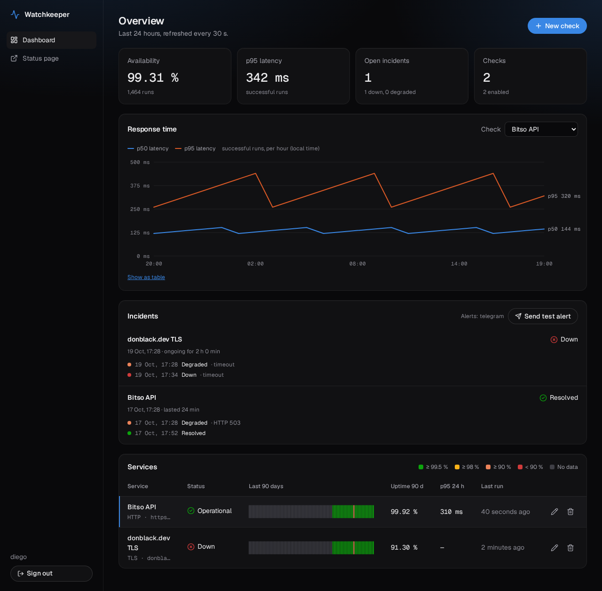
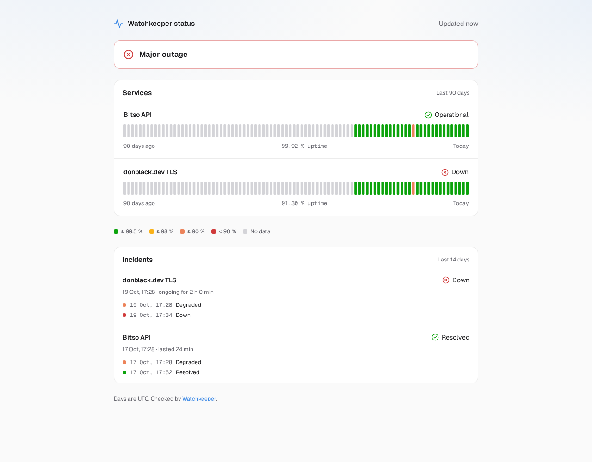
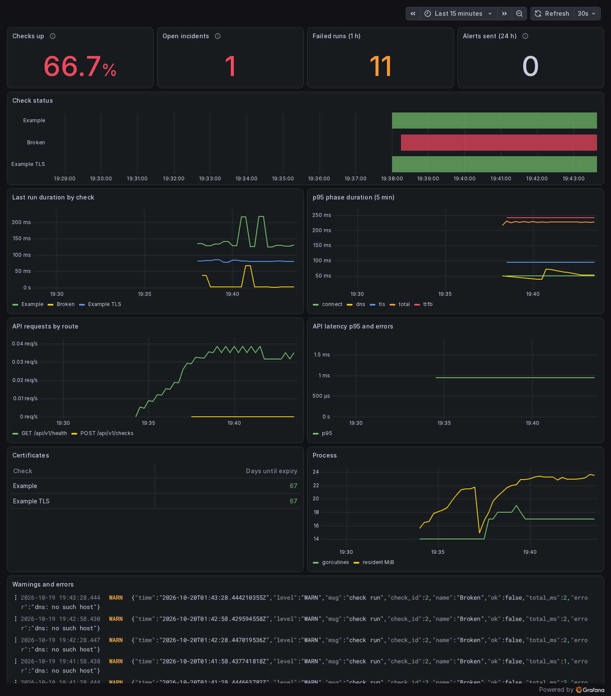

# Watchkeeper

[](https://github.com/DonBlack-117/watchkeeper/actions/workflows/ci.yml)

Uptime monitor and status page with AI incident triage, written in Go.

Watchkeeper checks your HTTP endpoints, DNS records and TLS certificates on a schedule, stores every run in PostgreSQL, and shows the results in a React dashboard and a public status page. It opens an incident when a service goes down, alerts you on Telegram, and exports Prometheus metrics and JSON logs to a Grafana dashboard with Loki. It ships as one container image and deploys to AWS from GitHub Actions. The last phase adds an agent that uses Claude to investigate incidents.

> **Status:** phases 1 (Go core), 2 (dashboard and deployment) and 3 (incidents, alerts and observability) are done. See the [roadmap](#roadmap).







## Features

- **HTTP checks** with the time spent in each phase (DNS, connect, TLS, time to first byte), expected status codes and certificate expiry.
- **DNS checks** that resolve a hostname.
- **TLS checks** that fail 7 days before a certificate expires.
- **Scheduler** with one goroutine per check, random start jitter, a concurrency limit and graceful shutdown. Checks created or edited through the API are picked up without a restart.
- **REST API** with cursor pagination, 90-day daily uptime and [RFC 9457 problem details](docs/problems.md).
- **Public status endpoint** that exposes names and states, never targets or errors.
- **Dashboard** in React and strict TypeScript: availability, p95 latency, open incidents, p50/p95 response time per hour, 90-day bars per service, and a form to create, edit and delete checks.
- **Public status page** at `/status`, light themed, with 90 days of history per service.
- **Single binary:** the frontend is embedded with `go:embed`, so the image has no web server of its own.
- **Incidents:** opened when a check stops being operational, escalated from degraded to down, and resolved on recovery, with a timeline shown in the dashboard and, without error details, on the status page.
- **Telegram alerts** when a check goes down and when it recovers (with the duration), and 30 and 14 days before a certificate expires. Short blips never alert, delivery is queued with retries, and the dashboard has a "Send test alert" button.
- **Prometheus metrics** on a separate internal port: check status, phase durations, API traffic and latency, alerts, incidents and Go runtime.
- **Grafana and Loki** in an optional Compose profile, with the data sources, a dashboard and alert rules provisioned from the repository. Grafana alerts on Telegram if Watchkeeper itself stops.

## Quick start

Requirements: Go 1.26+, Node 22+, and Podman or Docker.

```bash
make db          # PostgreSQL 16 on 127.0.0.1:5432
make web         # builds the frontend into the binary
make run         # applies migrations and listens on 127.0.0.1:8090
make seed        # creates a few example checks (in another terminal)
```

Open <http://127.0.0.1:8090> for the dashboard and <http://127.0.0.1:8090/status> for the public page. On loopback without `WK_API_TOKEN` or `WK_ADMIN_USER` there is no login; set `WK_ADMIN_USER` and `WK_ADMIN_PASSWORD` to try it.

```bash
curl -s localhost:8090/api/v1/status | jq
```

Settings come from environment variables; see [`.env.example`](.env.example).

## API

| Method and path                                            | Description                                                      |
| ---------------------------------------------------------- | ---------------------------------------------------------------- |
| `GET /api/v1/health`                                       | Service and database health                                      |
| `GET /api/v1/checks`                                       | All checks with their current status and last result             |
| `POST /api/v1/checks`                                      | Create a check (`201` with `Location`)                           |
| `GET /api/v1/checks/{id}`                                  | One check                                                        |
| `PATCH /api/v1/checks/{id}`                                | Change any field, for example `{"enabled": false}`               |
| `DELETE /api/v1/checks/{id}`                               | Delete a check and its results                                   |
| `GET /api/v1/checks/{id}/results?limit=&cursor=&from=&to=` | Run history, newest first                                        |
| `GET /api/v1/checks/{id}/uptime?days=90`                   | Availability per UTC day; days without runs have `percent: null` |
| `GET /api/v1/checks/{id}/latency?window=24h`               | p50 and p95 of successful runs per hour (`1h` to `168h`)         |
| `GET /api/v1/summary`                                      | Dashboard KPIs for the last 24 hours                             |
| `GET /api/v1/status`                                       | Public summary for a status page, with 90 daily percentages      |
| `POST /api/v1/auth/login`                                  | Dashboard login; sets the session cookie                         |
| `POST /api/v1/auth/logout`                                 | Ends the session                                                 |
| `GET /api/v1/auth/me`                                      | Whether a login is required and who is signed in                 |
| `GET /api/v1/incidents?limit=&checkId=&open=`              | Incidents newest first, each with its timeline                   |
| `POST /api/v1/alerts/test`                                 | Sends a test message to every alert channel                      |

Create a check:

```bash
curl -s -X POST localhost:8090/api/v1/checks \
  -H 'Content-Type: application/json' \
  -d '{"name":"Bitso API","kind":"http","target":"https://api.bitso.com/v3/ticker/?book=btc_mxn","intervalS":60}'
```

| Field            | Default        | Rules                                                       |
| ---------------- | -------------- | ----------------------------------------------------------- |
| `name`           |                | 1 to 100 characters                                         |
| `kind`           |                | `http`, `dns` or `tls`                                      |
| `target`         |                | URL for `http`, hostname for `dns`, `host[:port]` for `tls` |
| `intervalS`      | 60             | 30 to 86400                                                 |
| `timeoutMs`      | 10000          | 1000 to 30000, shorter than the interval                    |
| `expectedStatus` | any 2xx or 3xx | `http` only                                                 |
| `enabled`        | `true`         |                                                             |

A check is **operational** when its last three runs passed, **degraded** when some failed or the last one took more than 2 s, and **down** when all three failed.

## Security

- **Private targets are blocked by default.** Every connection is checked at dial time, so loopback, private ranges, link-local addresses (including cloud metadata) and redirects or DNS answers that point to them fail with `blocked`. `make run` sets `WK_ALLOW_PRIVATE_TARGETS=true` for local development; keep it off on a public server.
- **Admin API behind a login or a token.** With `WK_ADMIN_USER` or `WK_API_TOKEN` set, every endpoint except `/status`, `/health` and the login flow needs a dashboard session or `Authorization: Bearer <token>`. Watchkeeper refuses to start on a non-loopback address without one of them.
- **Sessions:** passwords are hashed with bcrypt, the session token is 32 random bytes stored only as a SHA-256 hash, and the cookie is `HttpOnly`, `Secure` and `SameSite=Strict`. Requests that change data with the cookie must carry a matching `Origin` header, and logins are limited to 10 per minute per IP.
- **Public status is cached and rate limited:** 15 s cache and 60 requests per minute per client IP. Behind a proxy listed in `WK_TRUSTED_PROXIES`, the client IP comes from the rightmost untrusted `X-Forwarded-For` entry, so the header cannot be spoofed.
- **Frontend headers:** a strict Content Security Policy (`script-src 'self'`, no inline code), `X-Frame-Options: DENY` and `nosniff`. Fonts are bundled, so the page loads nothing from third parties.
- Errors stored with results are short categories (`timeout`, `connection refused`, `dns: no such host`), never raw network errors with internal addresses.
- Results older than `WK_RETENTION_DAYS` (90) are deleted every hour in small batches.

## Development

```bash
make test        # unit and integration tests with the race detector
make test-short  # skips the PostgreSQL integration tests
make lint        # go vet and golangci-lint
make web-dev     # Vite on :5173 with hot reload, proxying /api to :8090
make web-test    # ESLint, tsc, Vitest and Playwright
make image       # builds the container image
```

The frontend tests run in two layers: Vitest with Testing Library for components, and Playwright on desktop Chrome and a Pixel 7 viewport with a mocked API (login with the keyboard, dialogs that trap and return focus, the chart read with arrow keys or as a table, no horizontal scroll on the status page).

Integration tests start PostgreSQL with [Testcontainers](https://golang.testcontainers.org/). With rootless Podman, start the socket once (`systemctl --user start podman.socket`); the Makefile points Testcontainers at it.

```text
cmd/watchkeeper/     entry point, configuration and graceful shutdown
internal/check/      check types, validation, status rules and runners
internal/scheduler/  one goroutine per check, reloads the list every 30 s
internal/store/      PostgreSQL with pgx; embedded goose migrations
internal/api/        REST handlers, sessions, problem details and request logging
internal/incident/   incident state machine, alert messages and certificate warnings
internal/notify/     alert queue with retries; Telegram Bot API client
internal/metrics/    Prometheus registry and per-check collectors
internal/ui/         embeds the built frontend and serves it with SPA fallback
migrations/          SQL migrations
web/                 React + TypeScript dashboard and status page (Vite)
deploy/              production Compose stack, Caddyfile, EC2 user data and the
                     observability profile (Prometheus, Loki, Alloy, Grafana)
```

## Deployment

`Dockerfile` builds the frontend with Node, cross-compiles Go for amd64 and arm64, and copies the binary into a distroless non-root image. On every push to `main` that passes CI, the `Deploy` workflow publishes `ghcr.io/donblack-117/watchkeeper` and, once the server is configured, rolls it out to EC2 over SSH and waits for `/api/v1/health`. The server runs the app, PostgreSQL and Caddy (automatic HTTPS) with Docker Compose. Step-by-step setup: [docs/deploy.md](docs/deploy.md).

## Observability

| Signal  | Where                                                                                                 |
| ------- | ----------------------------------------------------------------------------------------------------- |
| Metrics | `GET /metrics` on `WK_METRICS_ADDR` (internal port 9464 in Compose), scraped by Prometheus every 15 s |
| Logs    | JSON from `log/slog` on stdout; Alloy ships them to Loki with the `service` and `level` labels        |
| Alerts  | Watchkeeper sends incident and certificate alerts; Grafana alerts when Watchkeeper is unreachable     |

Main metrics: `watchkeeper_check_up`, `watchkeeper_check_phase_duration_seconds` (histogram by phase), `watchkeeper_check_runs_total`, `watchkeeper_check_cert_expiry_timestamp_seconds`, `watchkeeper_http_requests_total` and `watchkeeper_http_request_duration_seconds` (by route pattern), `watchkeeper_incidents_open` and `watchkeeper_notifications_total`.

```bash
docker compose --profile observability up -d   # on the server, see docs/deploy.md
```

Grafana is served at `https://grafana.<domain>`, a separate origin from the dashboard, with its own admin account. Alloy reads container logs through a socket proxy that only allows read-only container endpoints, on a network no other service joins.

## Roadmap

1. **Go core** — checks, scheduler, storage, REST API. ✅
2. **Dashboard** — React and TypeScript UI, public status page, deployment on AWS with CI/CD. ✅
3. **Observability** — incidents, Telegram alerts, Prometheus metrics, Loki logs and Grafana. ✅
4. **AI triage** — an agent that uses Claude tool use (`dig`, `curl`, history queries) to explain incidents, plus an MCP server.

Security reports: see [SECURITY.md](SECURITY.md).

## License

MIT. See [LICENSE](LICENSE).
