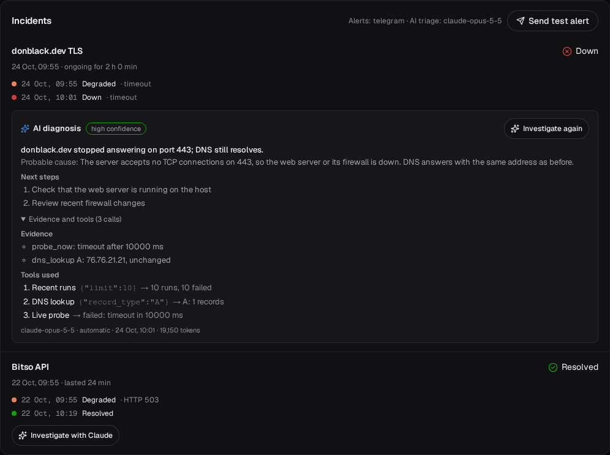

# AI incident triage

When a check goes down, Watchkeeper can ask Claude to find out why. An agent reads the check's history, probes the endpoint the way an engineer would with `dig`, `curl` and `openssl s_client`, and writes a short diagnosis: a summary, the probable cause with a confidence level, the evidence behind it and the next steps. The dashboard shows it under the incident, and the Telegram alert gets a follow-up message with the summary.

## Turning it on

Set `WK_ANTHROPIC_API_KEY` (or `ANTHROPIC_API_KEY`) and restart. Without a key the feature is off and the dashboard says so.

| Variable                | Default           | Meaning                                                               |
| ----------------------- | ----------------- | --------------------------------------------------------------------- |
| `WK_ANTHROPIC_API_KEY`  |                   | Anthropic API key; enables triage                                     |
| `WK_TRIAGE_MODEL`       | `claude-opus-5-5` | Model id                                                              |
| `WK_TRIAGE_EFFORT`      | `high`            | `low`, `medium`, `high`, `xhigh` or `max`; deeper means more tokens   |
| `WK_TRIAGE_AUTO`        | `true`            | Investigate each incident once, the first time it goes down           |
| `WK_TRIAGE_DAILY_LIMIT` | `20`              | Investigations started in any 24 hours, automatic and manual together |

Manual runs: the **Investigate with Claude** button on each incident, `POST /api/v1/incidents/{id}/triage`, or the `investigate_incident` tool of the [MCP server](mcp.md).

## How the agent works

`internal/triage` runs a tool-use loop against the Messages API (Go SDK, `client.Beta.Messages.New`):

1. The first message states the facts: check name, kind, target, interval, timeout, expected status, the status rules and the incident timeline.
2. Claude calls tools until it has enough evidence, at most 10 model calls per investigation. Tool calls of one turn run and go back in a single message.
3. The final answer follows a JSON schema (structured outputs), so it can be stored without parsing prose.

| Tool              | Like                  | What it returns                                                      |
| ----------------- | --------------------- | -------------------------------------------------------------------- |
| `recent_results`  | reading the logs      | Latest stored runs with per-phase timings and error categories       |
| `latency_by_hour` | a Grafana panel       | p50 and p95 per hour, with run counts                                |
| `past_incidents`  | the incident history  | Earlier incidents of the same check and the causes found then        |
| `dns_lookup`      | `dig`                 | A, AAAA, CNAME, MX, NS or TXT records of the check's host            |
| `probe_now`       | `curl -w` with timing | One live run of the check, not stored                                |
| `inspect_tls`     | `openssl s_client`    | Certificate subject, issuer, names, validity, chain and why it fails |

Request settings: adaptive thinking (the default on Claude Opus 5.5), `output_config.effort` from `WK_TRIAGE_EFFORT`, strict tool schemas, prompt caching of the tools and system prompt, and server-side refusal fallbacks (`fallbacks: "default"` with the `server-side-fallback-2026-07-01` beta), so a safety classifier decline is retried on a fallback model inside the same call. Thinking blocks are passed back unchanged between turns.

## Safety

- **Probes only reach the incident's own check.** The model chooses which probe to run, never the host or URL, so text in a DNS record or an error message cannot point it at another address. Probes go through the same private-address guard as the checks (`WK_ALLOW_PRIVATE_TARGETS`).
- **Tool output is data.** The system prompt says so, and tools return short error categories and timings, never response bodies.
- **The public status page never shows a diagnosis.** It is only in the authenticated API and the dashboard.
- **Cost is bounded:** a daily limit, 5 manual runs per minute, 2 investigations at a time, a 4-minute timeout and 16,000 output tokens per model call.

## What it sends to Anthropic

Check names and targets, the incident timeline, stored results and the output of the probes. No credentials, cookies or response bodies. Leave `WK_ANTHROPIC_API_KEY` empty if that is not acceptable for your targets.

## Cost

A typical investigation makes 2 to 4 model calls with 15,000 to 30,000 input tokens (most of them cached after the first call) and under 2,000 output tokens. The dashboard shows the tokens of each run, and Prometheus has `watchkeeper_triage_runs_total{result}` and `watchkeeper_triage_tokens_total{direction}`. Set a spend limit on the API key as well.

## Failures

An investigation that cannot finish is stored as `failed` with a short reason: the API rejected the key, the rate limit was reached, the model declined, the answer was not valid JSON, or it timed out. Investigations left running by a restart are marked failed at startup. Press **Investigate again** to retry.
